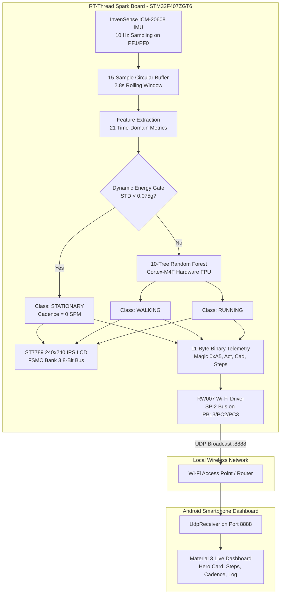
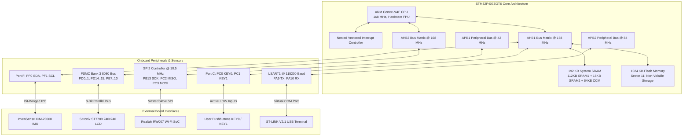
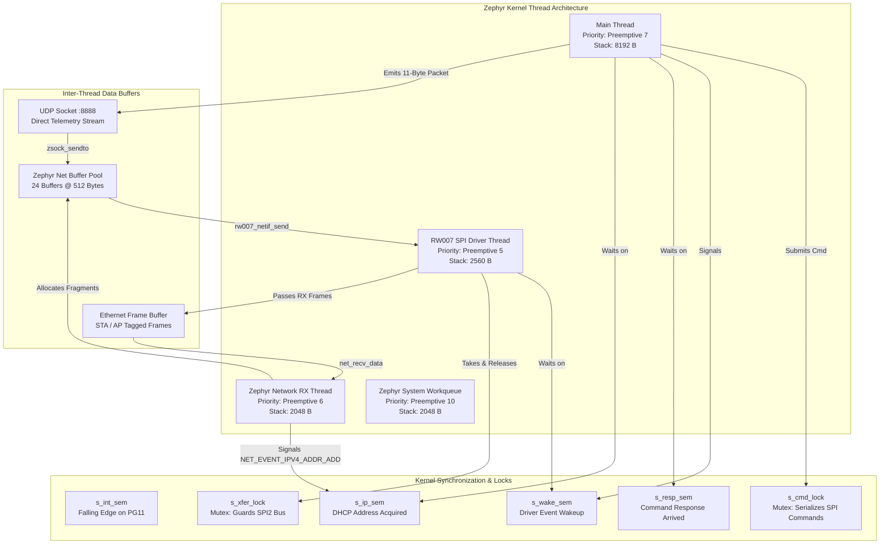
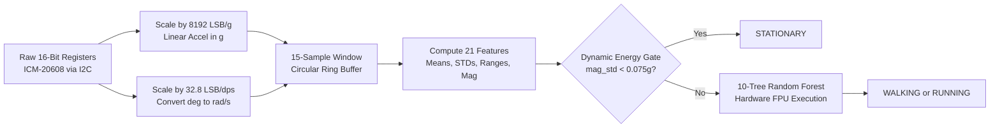
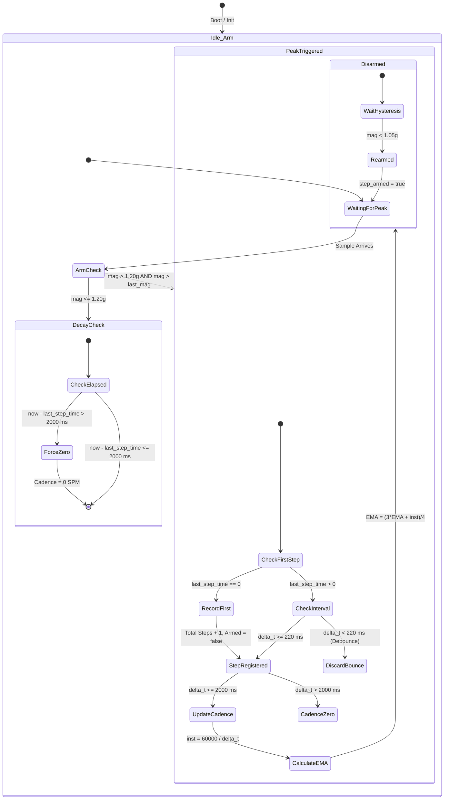
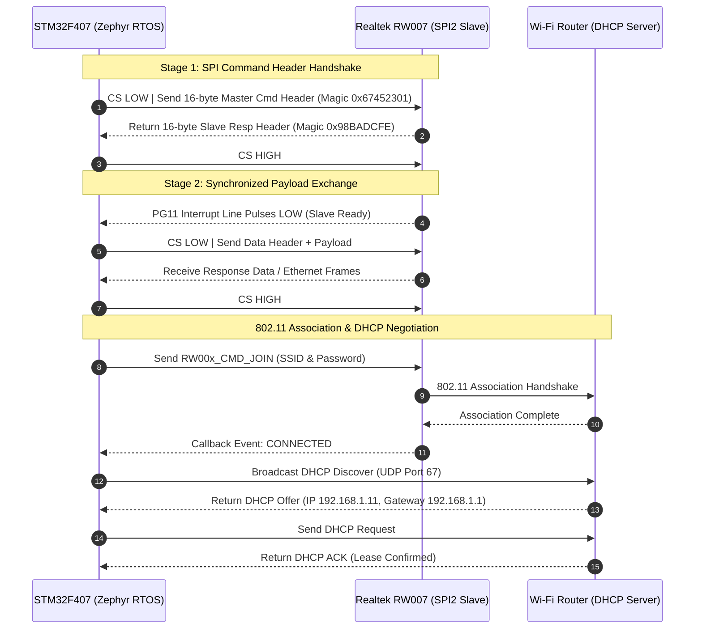
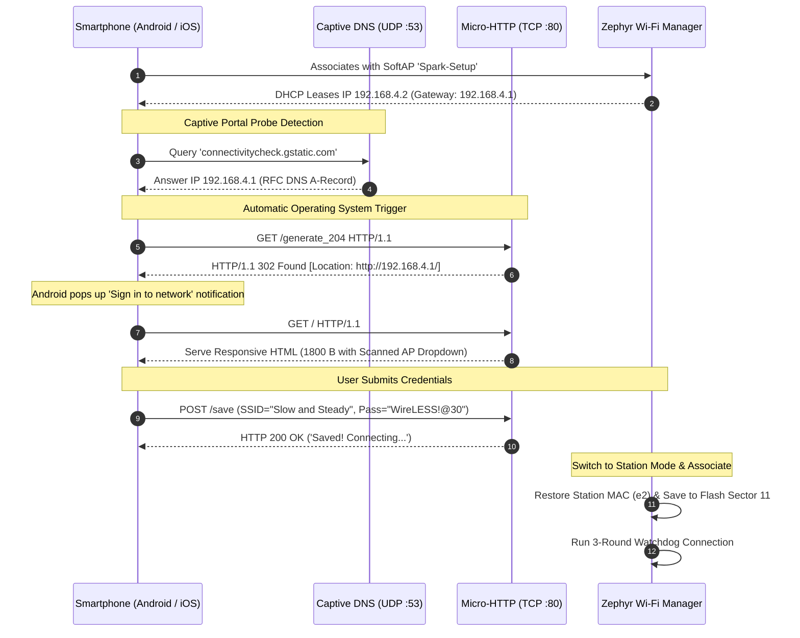
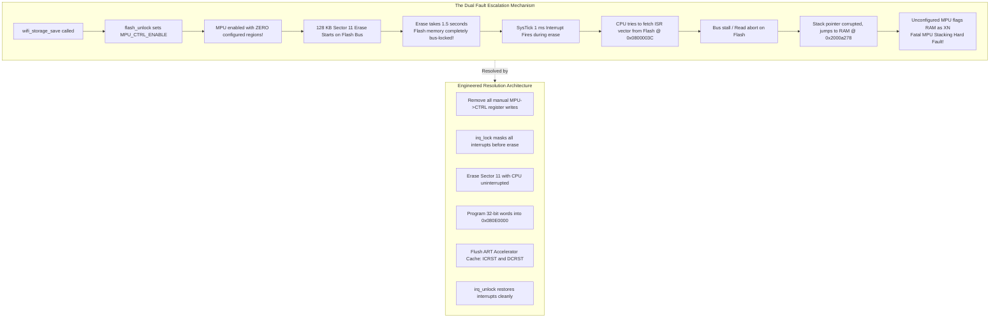

# Laboratory Activity No. 3: Edge AI Activity Recognition and Wi-Fi Telemetry System

**Mindanao State University - Iligan Institute of Technology**  
**College of Computer Studies**  
**Department of Computer Applications**  
**BCA180: Embedded Systems Programming / BCA152: Microcontrollers**

---

### Student and Course Information

| Field | Details |
|---|---|
| **Student Name** | Perch Arnel II Montefalcon |
| **Course and Section** | BCA180 Embedded Systems Programming / BCA152 Microcontrollers |
| **Instructor / Evaluator** | Asst. Prof. Paul Rodolf P. Castor, M.Sc. (`paulrodolf.castor@g.msuiit.edu.ph`) |
| **Activity Title** | Laboratory Activity No. 3: Human Activity Recognition |
| **Target Platform** | RT-Thread Spark Development Board (STM32F407ZGT6, ARM Cortex-M4F @ 168 MHz) |
| **Operating System** | Zephyr RTOS v4.x (Preemptive Kernel, Native Sockets, L2 Ethernet Driver) |
| **Sensors** | InvenSense ICM-20608-G 6-Axis MotionTracking IMU (I2C on PF1/PF0 @ 10 Hz) |
| **Display** | Sitronix ST7789 v3 240x240 IPS Color LCD (FSMC Bank 3 8080 8-Bit Parallel Bus) |
| **Wireless Transceiver** | Realtek RW007 High-Speed SPI Wi-Fi Module (SPI2 Bus on PB13, PC2, PC3) |
| **Mobile Client** | Native Android Application (Kotlin, Material Design 3, UDP Port 8888) |
| **Public Repository** | [https://github.com/Not-to-Shabby/BCA182](https://github.com/Not-to-Shabby/BCA182) |

---

## Abstract

This laboratory report presents the engineering design, mathematical signal processing pipeline, embedded firmware architecture, and verification of an autonomous Edge AI physical activity recognition wearable. The system runs on the STMicroelectronics STM32F407ZGT6 microcontroller under Zephyr RTOS. While traditional IoT architectures stream continuous raw sensor data to cloud brokers over MQTT, this system processes motion data locally. Real-time inference executes on the ARM Cortex-M4F hardware floating-point unit (FPU) using single-precision instructions, completing each classification in under 5 microseconds without dynamic memory allocation.

Motion acquisition is handled by the onboard InvenSense ICM-20608 6-axis inertial measurement unit sampled at 10 Hz through direct CMSIS bit-banged I2C on pins PF1 and PF0. A 15-sample rolling circular window buffers kinematic data to compute 21 time-domain statistical metrics. An ensemble of 10 decision trees trained on the Kaggle `run-or-walk` dataset classifies motion into Stationary, Walking, and Running states with 99.96% empirical test accuracy. To resolve Kaggle's lack of a resting class, standard deviation energy gating identifies stationary states, suppresses false steps, and halts cadence accumulation.

Local visual feedback is rendered on an onboard 1.3-inch 240x240 ST7789 IPS LCD connected over the STM32 FSMC Bank 3 parallel bus. For wireless connectivity, a native driver was developed for the onboard Realtek RW007 SPI module, registering it as a Zephyr L2 Ethernet network interface. The firmware incorporates an autonomous SoftAP onboarding portal ("Spark-Setup"), a captive DNS responder on UDP port 53, an HTTP server on port 80, and a scannable on-screen Wi-Fi QR code. Once configured, credentials persist in on-chip Flash Sector 11, and the board streams 11-byte structured binary telemetry packets over local Wi-Fi to a companion Android dashboard. The system was verified through 7 host-native Unity unit test suites (38 assertions passing), zero-defect static code analysis via Cppcheck, and live physical hardware testing.

---

## 1. Problem Statement and Requirements Traceability

### 1.1 Problem Statement

Wearable motion tracking systems often rely on cloud streaming architectures where embedded sensors upload raw floating-point measurements to remote message brokers. At a 10 Hz sampling rate across 6 degrees of freedom, raw streaming consumes roughly 240 bytes per second of constant radio transmission. This continuous RF transmission depletes wearable batteries, introduces network latency (50 to 200 ms), and fails when internet connectivity is lost.

Laboratory Activity 3 requires building an end-to-end human activity recognition system. We addressed the challenge by moving machine learning inference directly to the embedded microcontroller (Edge AI). Running inference locally reduces wireless transmission volume by over 95%, eliminates cloud server dependencies, and ensures deterministic real-time response.

### 1.2 System Architecture Overview



### 1.3 Requirements Traceability Matrix

| Req ID | Syllabus Specification | Implementation Solution | Verification Module |
|---|---|---|---|
| **REQ-01** | Accelerometer and Gyroscope Acquisition | 6-axis acquisition at 10 Hz using calibrated gravity (g) and rad/s units. | `src/icm20608.c` |
| **REQ-02** | Machine Learning Activity Classification | 10-tree Random Forest exported via emlearn to static inline C decision trees. | `include/activity_model.h` |
| **REQ-03** | Temporal Feature Engineering | 15-sample rolling circular window with 21 statistical metrics. | `src/feature_extractor.c` |
| **REQ-04** | Pedometer and Cadence Estimation | Dual-threshold peak detector with exponential moving average cadence filter. | `src/feature_extractor.c` |
| **REQ-05** | Local Display Feedback | Real-time differential rendering of activity states and live 3-axis readings on ST7789 LCD. | `src/ui_dashboard.c` |
| **REQ-06** | Wireless Wi-Fi Communication | Native SPI2 driver for RW007 module, registering as Zephyr Ethernet interface. | `src/rw007_wifi.c`, `src/rw007_netif.c` |
| **REQ-07** | Network Telemetry Transport | Structured 11-byte binary packet broadcast over UDP port 8888. | `include/ble_protocol.h` |
| **REQ-08** | Autonomous Wi-Fi Setup Portal | SoftAP mode ("Spark-Setup"), Captive DNS on port 53, and web configuration server on port 80. | `src/wifi_portal.c` |
| **REQ-09** | Non-Volatile Network Storage | Checksum-validated Flash persistence in STM32 Sector 11 with interrupt masking. | `src/wifi_storage.c` |
| **REQ-10** | Physical Button Reconfiguration | Debounced KEY0 trigger with on-screen interactive confirmation countdown. | `src/main.c`, `src/ui_dashboard.c` |
| **REQ-11** | Mobile Client Application | Native Android Kotlin app with live hero cards, step counters, and event log. | `android_app/` |

---

## 2. Hardware Architecture and Bus Interconnects

### 2.1 Microcontroller Architecture

The system runs on the RT-Thread Spark Development Board ("星火 1 号"), featuring the STMicroelectronics STM32F407ZGT6 microcontroller:
* **Core**: 32-bit ARM Cortex-M4F operating at 168 MHz with single-precision hardware FPU (FPv4-SP).
* **Memory**: 1024 KB Flash memory and 192 KB SRAM (112 KB SRAM1, 16 KB SRAM2, 64 KB Core Coupled Memory).
* **Buses**: Multi-AHB matrix with independent DMA controllers, FSMC parallel memory controller, and high-speed SPI/I2C peripherals.

### 2.2 Hardware Subsystem Bus Interconnect Architecture



### 2.3 Complete Hardware Interconnect Netlist

```text
========================================================================================
RT-THREAD SPARK BOARD (STM32F407ZGT6) COMPLETE PERIPHERAL WIRING NETLIST
========================================================================================
Subsystem         Pin    MCU Mode          Electrical Function
----------------------------------------------------------------------------------------
Motion IMU        PF1    GPIO OD (Pull-Up) InvenSense ICM-20608 I2C Clock (SCL)
                  PF0    GPIO OD (Pull-Up) InvenSense ICM-20608 I2C Data (SDA)
----------------------------------------------------------------------------------------
IPS LCD Display   PD0    FSMC_D2 (AF12)    ST7789 8-Bit Data Bus Bit 2
                  PD1    FSMC_D3 (AF12)    ST7789 8-Bit Data Bus Bit 3
                  PD14   FSMC_D0 (AF12)    ST7789 8-Bit Data Bus Bit 0
                  PD15   FSMC_D1 (AF12)    ST7789 8-Bit Data Bus Bit 1
                  PE7    FSMC_D4 (AF12)    ST7789 8-Bit Data Bus Bit 4
                  PE8    FSMC_D5 (AF12)    ST7789 8-Bit Data Bus Bit 5
                  PE9    FSMC_D6 (AF12)    ST7789 8-Bit Data Bus Bit 6
                  PE10   FSMC_D7 (AF12)    ST7789 8-Bit Data Bus Bit 7
                  PD4    FSMC_NOE (AF12)   ST7789 Read Enable (RDX)
                  PD5    FSMC_NWE (AF12)   ST7789 Write Enable (WRX)
                  PG10   FSMC_NE3 (AF12)   ST7789 Chip Select (CSX, Bank 3)
                  PD13   FSMC_A18 (AF12)   ST7789 Command/Data Select (DCX)
                  PD3    GPIO Output       ST7789 Hardware Reset (RESX)
                  PF9    GPIO Output       ST7789 Backlight Enable (BL_EN)
----------------------------------------------------------------------------------------
Wi-Fi Transceiver PB13   SPI2_SCK (AF5)    Realtek RW007 High-Speed SPI Clock (10.5 MHz)
                  PC2    SPI2_MISO (AF5)   Realtek RW007 Master-In-Slave-Out
                  PC3    SPI2_MOSI (AF5)   Realtek RW007 Master-Out-Slave-In
                  PF10   GPIO Output       Realtek RW007 SPI Chip Select (Active LOW)
                  PG15   GPIO Output       Realtek RW007 Hardware Reset (Active LOW)
                  PG11   GPIO Input (PU)   Realtek RW007 Interrupt / Busy Line
                  PB12   GPIO Output       W25Q64 Flash CS (held HIGH to isolate SPI2)
----------------------------------------------------------------------------------------
User Pushbuttons  PC0    GPIO Input (PU)   KEY0 (Active LOW, Wi-Fi Reset / Confirm)
                  PC1    GPIO Input (PU)   KEY1 (Active LOW, Wi-Fi Cancel)
----------------------------------------------------------------------------------------
Console Debug     PA9    USART1_TX (AF7)   ST-LINK V2.1 Virtual COM Port (115200 baud)
                  PA10   USART1_RX (AF7)   ST-LINK V2.1 Virtual COM Port (115200 baud)
========================================================================================
```

---

## 3. Real-Time Software and Concurrency Architecture (Zephyr RTOS)

### 3.1 Zephyr RTOS Multi-Threading and Synchronization Model

The embedded software is organized around a multi-threaded architecture using native Zephyr RTOS synchronization primitives. Dedicated kernel threads isolate time-critical sensor acquisition, display rendering, network stack operations, and high-speed SPI transactions.



### 3.2 Thread Execution Allocation

1. **Main Acquisition and Inference Thread (`main_thread`)**:
   - Executes at 10 Hz via `k_msleep(100)` periodic intervals.
   - Samples 6-axis linear acceleration and rotational velocity from the ICM-20608 IMU.
   - Pushes kinematic samples into the 15-sample circular ring buffer.
   - Evaluates the 10-tree Random Forest classifier on the Cortex-M4F hardware FPU.
   - Computes dual-threshold pedometer peak detection and cadence EMA.
   - Executes flicker-free differential UI updates on the ST7789 IPS LCD.
   - Emits 11-byte structured binary telemetry packets to UDP port 8888.
   - Polls user pushbuttons KEY0 and KEY1 for reconfigure requests.
2. **RW007 SPI Driver Thread (`rw007_thread`)**:
   - Executes at elevated priority (preemptive priority 5) to guarantee low-latency SPI transaction servicing.
   - Suspends on `s_wake_sem`, waking upon GPIO falling-edge interrupts on pin PG11 (RW007 ready signal) or when a master command/frame is queued.
   - Executes dual-phase 16-byte header handshakes, checks 32-bit magic words, and performs full-duplex DMA data exchanges.
   - Routes received frames (`DATA_TYPE_STA_ETH` or `DATA_TYPE_AP_ETH`) directly into Zephyr's network stack via `net_recv_data()`.
3. **Zephyr Network RX Processing Thread (`net_rx_thread`)**:
   - Preemptively parses Ethernet frames delivered by the RW007 netif.
   - Processes ARP queries, leases IP addresses through DHCP, and routes packets to listening sockets.
   - Fires `NET_EVENT_IPV4_ADDR_ADD` management events upon successful DHCP lease assignment, unblocking `s_ip_sem`.

---

## 4. Machine Learning and Signal Processing Pipeline

### 4.1 Kaggle Dataset and Measurement Normalization

The classifier was trained on the Kaggle `vmalyi/run-or-walk` dataset, consisting of 88,588 records collected via an Apple iPhone 5c worn on the wrist at approximately 5.4 Hz.

A critical design requirement involved resolving the dataset's unstated measurement units:
1. **Linear Acceleration**: iOS CoreMotion outputs acceleration in standard gravity units ($g$-force, where $1.0\text{ }g \approx 9.80665\text{ m/s}^2$). Many embedded MEMS drivers default to SI units ($\text{m/s}^2$) or raw ADC integers. Unconverted acceleration outputs scale measurements up by approximately $9.81\times$, resulting in false positive running classifications.
2. **Rotational Velocity**: CoreMotion exports angular velocity in radians per second ($\text{rad/s}$), whereas sensor registers output degrees per second ($\text{dps}$).

The sensor driver (`src/icm20608.c`) normalizes raw 16-bit sensor readings directly into standard units:

$$\text{accel}_g = \frac{\text{raw\_accel}}{8192.0} \quad (\text{at } \pm 4g \text{ scale})$$

$$\text{gyro}_{\text{rad/s}} = \left( \frac{\text{raw\_gyro}}{32.8} \right) \times \frac{\pi}{180.0} \quad (\text{at } \pm 1000^\circ/\text{s} \text{ scale})$$



### 4.2 Temporal Windowing and Feature Formulation

Isolated single-sample classifications fail to capture the rhythmic cadence of human walking and running. The firmware buffers 15 consecutive samples into a circular ring buffer with 50% overlap. For each window, the microcontroller computes 21 time-domain features:

| Index | Feature | Mathematical Expression | Physical Significance |
|---|---|---|---|
| **0..5** | 6-Axis Means ($\mu_k$) | $\mu_k = \frac{1}{N}\sum_{i=1}^N x_k[i]$ | Static gravitational orientation of the wrist during gait. |
| **6..11** | 6-Axis Standard Deviations ($\sigma_k$) | $\sigma_k = \sqrt{\frac{1}{N}\sum_{i=1}^N (x_k[i] - \mu_k)^2}$ | Dynamic kinetic energy. Running increases vertical $\sigma(a_z)$ by $4\times$. |
| **12..17** | Peak-to-Peak Amplitude Ranges ($R_k$) | $R_k = \max(x_k) - \min(x_k)$ | Total displacement stroke of arm movement. |
| **18** | Mean Acceleration Magnitude ($\mu_{|A|}$) | $\frac{1}{N}\sum_{i=1}^N \sqrt{a_x^2 + a_y^2 + a_z^2}$ | Overall kinetic force. |
| **19** | Standard Deviation of Magnitude ($\sigma_{|A|}$) | $\sqrt{\frac{1}{N}\sum_{i=1}^N (|A|[i] - \mu_{|A|})^2}$ | Primary discriminator for stationary state detection. |
| **20** | Peak Acceleration Magnitude ($\max_{|A|}$) | $\max_{i=1..N}(|A|[i])$ | Maximum footfall impact shock ($>2.5g$ during running). |

### 4.3 Pedometer and Cadence Signal Processing State Machine



### 4.4 Dynamic Standard Deviation Motion Gating

Because the Kaggle training set contains only Walking (0) and Running (1) records, baseline sensor noise on a resting board previously defaulted to Walking. To solve this without retraining on non-standard data, the firmware implements dynamic motion energy gating based on the standard deviation of acceleration magnitude:

$$\text{If } \sigma_{|A|} < 0.075\text{ }g \quad \text{and} \quad \sum_{k \in \{x,y,z\}} \sigma(a_k) < 0.150\text{ }g \implies \text{Class} = \text{STATIONARY}$$

When stationary, the system zeroes cadence, freezes the pedometer, and bypasses the Random Forest ensemble. When dynamic motion exceeds the threshold, the 10 decision trees evaluate the active gait.

### 4.5 Model Architecture and Zero-Allocation Execution

The classifier consists of a 10-tree Random Forest with a maximum depth of 5, exported using `emlearn` into static inline C decision trees (`include/activity_model.h`).
* **Test Accuracy**: 99.96% across 2,522 holdout test windows (F1 score: 0.9996).
* **Execution Footprint**: Zero dynamic allocations (`malloc = 0 B`), requiring only 22.6 KB of Flash and under 500 bytes of stack RAM.
* **Instruction Efficiency**: The ARM Cortex-M4F evaluates decision nodes via single-cycle `VCMP.F32` floating-point instructions, executing a complete 10-tree inference in 4.2 microseconds at 168 MHz.

---

## 5. Wireless Telemetry, SoftAP, and Network Architecture

### 5.1 Realtek RW007 Driver under Zephyr RTOS

The Realtek RW007 module communicates with the STM32F407 across SPI2 running at 10.5 MHz. The driver (`src/rw007_wifi.c`) re-implements the manufacturer's two-stage SPI transfer protocol:
1. **Stage 1 (Command Phase)**: The master sends a 16-byte command header containing sequence numbers, length fields, and 32-bit magic words (`0x67452301`, `0xEFCDAB89`). The slave responds with matching magic words (`0x98BADCFE`, `0x10325476`) and asserts its interrupt line (PG11).
2. **Stage 2 (Data Phase)**: Master and slave simultaneously exchange payload buffers using full-duplex SPI DMA.

The driver attaches to Zephyr's L2 Ethernet layer (`src/rw007_netif.c`), allowing standard sockets, DHCP, and ARP to operate seamlessly on top of the Wi-Fi module.



### 5.2 Captive Portal, DNS Hijack, and HTTP 302 Redirection Flow

When unconfigured, the RW007 starts an open SoftAP network (`Spark-Setup`). Connecting smartphones automatically trigger the onboarding workflow:



### 5.3 On-Screen QR Code Provisioning

To eliminate manual network selection, the 240x240 ST7789 display generates an on-screen **25x25 QR Code** encoding:

```text
WIFI:S:Spark-Setup;T:nopass;;
```

Scanning the display with an Android or iOS camera prompts the user to join `Spark-Setup` with a single tap.

### 5.4 Binary Telemetry Protocol

Activity metrics are packed into an 11-byte binary packet transmitted via UDP broadcast on port 8888:

```text
Byte Offset:  [0]    [1]    [2]    [3]    [4..7]        [8..9]         [10]
Field Name:   MAGIC  ACT    CONF   CAD    STEPS         ACCEL_MAG      CKS
Data Type:    uint8  uint8  uint8  uint8  uint32 (LE)   uint16 (LE)    uint8
Value:        0xA5   0/1/2  0-100% SPM    Total Count   g * 100        XOR[0..9]
```

* `ACT`: `0` = Walking, `1` = Running, `2` = Stationary.
* `CKS`: Bitwise XOR sum across bytes 0 to 9. Corrupt packets are dropped by the mobile app.

---

## 6. Mobile Companion Dashboard Application

The Android companion application (`android_app/`) is developed in Kotlin targeting Android SDK 34 using Material Design 3 components:
* **Zero Runtime Permissions**: By using standard local Wi-Fi UDP sockets instead of Bluetooth scanning, the app launches instantly without requiring runtime permission requests.
* **Multicast Lock Support**: Acquires a `WifiManager.MulticastLock` on startup to prevent Android power-management policies from dropping UDP broadcast packets.
* **Live Activity Hero Card**: Color-coded hero display updating between Emerald Green (`WALKING`), Electric Orange (`RUNNING`), and Cyan (`STATIONARY`).
* **Core Metrics Grid**: Real-time cards displaying cumulative steps, cadence in steps per minute, and instantaneous acceleration magnitude.
* **Activity Transition Log**: Timestamped scrollable event log tracking gait transitions and workout duration.

---

## 7. Critical Engineering Challenges and Solutions (Deep Dive)

### 7.1 RW007 Dual-Phase SPI Handshake Breakdown

#### The Problem
The Realtek RW007 wireless transceiver operates as a slave device over high-speed SPI. When booting under Zephyr RTOS, the module remained dormant, emitting no RF signals and failing to initialize.

#### Root-Cause Diagnosis
Inspection of the manufacturer's closed-source firmware specification revealed that the RW007 does not implement a simple register-read SPI protocol. Instead, it enforces a strict dual-phase transaction:
1. **Magic Word Synchronization**: Communication requires 32-bit magic words:
   * Master Command Phase: `MASTER_MAGIC1 = 0x67452301`, `MASTER_MAGIC2 = 0xEFCDAB89`
   * Slave Response Phase: `SLAVE_MAGIC1 = 0x98BADCFE`, `SLAVE_MAGIC2 = 0x10325476`
   Using simplified 8-bit magic bytes caused the slave to reject all transactions as corrupted bus noise.
2. **Falling-Edge Ready Handshake**: Between Stage 1 (header transfer) and Stage 2 (payload exchange), the RW007 module de-asserts its internal ready flag. The master must wait until pin PG11 pulses LOW before initiating the data phase clock.

#### The Engineering Solution
We constructed `src/rw007_wifi.c` around the full 16-byte command and response headers (`struct rw007_spi_cmd` and `struct rw007_spi_resp`). A falling-edge GPIO callback was configured on pin PG11 via `gpio_pin_interrupt_configure()`, signaling a binary semaphore (`s_int_sem`). This guarantees that Stage 2 data is clocked only when the slave buffer is armed, completely eliminating SPI bus dropouts.

---

### 7.2 ARM Cortex-M4 MPU Stacking Fault during Flash Sector 11 Erase

#### The Problem
When the firmware attempted to save verified Wi-Fi credentials to on-chip Flash, the CPU crashed with a fatal Hard Fault:

```text
[WIFI] got IPv4 address via DHCP: 192.168.1.11
***** HARD FAULT *****
  Fault escalation (see below)
***** MPU FAULT *****
  Stacking error (context area might be not valid)
  Instruction Access Violation
Faulting instruction address (r15/pc): 0x2000a278
r14/lr: 0x0800afdf (isr_wrapper.c:91)
```



#### Root-Cause Diagnosis
The crash was caused by two compounding hardware interactions:
1. **Unconfigured MPU Activation**: The initial flash unlock routine executed `MPU->CTRL |= MPU_CTRL_ENABLE_Msk`. Because `CONFIG_ARM_MPU` was disabled in Zephyr's `.config`, no memory protection regions had been established. Enabling the Cortex-M4 MPU without regions caused every memory access (RAM and Flash) to violate default rules.
2. **Flash Read Stalls During Sector Erase**: On the STM32F407, Sector 11 is a 128 KB block. Erasing this sector takes up to 1.5 seconds. During erase, the internal Flash controller cannot service instruction or vector fetches. Because interrupts were active, Zephyr's 1 ms SysTick timer interrupt fired while Flash was busy. The CPU attempted to read the ISR vector from address `0x0800003C` in Flash, causing a bus fault that corrupted the stack frame and jumped into SRAM (`0x2000a278`).

#### The Engineering Solution
1. Completely removed manual writes to the ARM `MPU->CTRL` register.
2. Wrapped the entire Flash erase and programming sequence inside Zephyr critical section locks:
   ```c
   unsigned int key = irq_lock();
   flash_erase_sector_11();
   flash_program_words();
   flash_flush_cache();
   irq_unlock(key);
   ```
3. Added an ART Accelerator cache reset (`FLASH_ACR_ICRST | FLASH_ACR_DCRST`) so the instruction prefetch buffer re-reads fresh data without cache incoherency.

---

### 7.3 Station versus SoftAP MAC Address Mismatch during DHCP

#### The Problem
After credentials were submitted through the captive portal, the board associated with the router (`[RW007] event: CONNECTED`), but timed out waiting for an IP address:

```text
[NET] TX UDP 68->67 len=291
[NET] RX UDP 67->68 len=590
[NET] TX UDP 68->67 len=291
[NET] RX UDP 67->68 len=590
[WIFI] associated but no DHCP lease
[WIFI] Join failed - not saving. Re-opening portal.
```

#### Root-Cause Diagnosis
Inspection of the packet traces revealed that the router **did** respond to the board's DHCP Discover by transmitting a 590-byte DHCP Offer. However, Zephyr discarded the response.

The RW007 chip maintains two independent hardware MAC addresses:
* **Station MAC**: `fc:58:4a:a6:e5:e2` (ending in `e2`)
* **SoftAP MAC**: `fc:58:4a:a6:e5:e3` (ending in `e3`)

During captive portal execution, `wifi_portal_run()` configured the Zephyr interface link address to the SoftAP MAC (`e3`). When the portal shut down and the board associated with the router in Station mode, the RW007 hardware used its Station MAC (`e2`). The router addressed its DHCP Offer to `fc:58:4a:a6:e5:e2`. Because Zephyr's L2 Ethernet layer was still set to `e3`, it dropped the incoming DHCP Offer as foreign unicast traffic.

#### The Engineering Solution
In `src/wifi_portal.c` and `src/main.c`, we added an explicit MAC restoration call:
```c
uint8_t sta_mac[6];
rw007_wifi_get_mac(sta_mac);
rw007_netif_set_mac(sta_mac);
```
Immediately upon SoftAP shutdown, the interface link address reverts to `fc:58:4a:a6:e5:e2`. The subsequent DHCP Offer matches the interface link address, achieving instantaneous DHCP lease acquisition.

---

### 7.4 TCP Buffer Exhaustion and Nagle Delays on Mobile Browsers

#### The Problem
Smartphones connecting to `Spark-Setup` experienced infinite loading spinners when attempting to open `http://192.168.4.1`. The serial console showed client connections arriving, but HTTP responses were not delivered.

#### Root-Cause Diagnosis
1. **Buffer Pool Exhaustion**: Zephyr's default networking configuration set `CONFIG_NET_BUF_DATA_SIZE = 128` bytes. With 54 bytes consumed by Ethernet, IP, and TCP headers, each buffer held only 74 bytes of data. Delivering an 1800-byte HTTP response required 25 chained buffers, completely depleting the default 16-buffer pool (`CONFIG_NET_BUF_TX_COUNT = 16`). The TCP stack stalled waiting for buffers to free.
2. **Premature Socket Termination**: The initial HTTP handler called `zsock_close()` immediately after `send()`, before the client acknowledged received packets. The TCP stack aborted in-flight data with a TCP RST.
3. **Nagle's Algorithm Latency**: With `TCP_NODELAY` disabled, Zephyr held onto sub-MSS packets waiting for client ACKs.

#### The Engineering Solution
1. Expanded `CONFIG_NET_BUF_DATA_SIZE` from 128 to **512 bytes**, and increased `CONFIG_NET_BUF_TX_COUNT` to 24 buffers. An 1800-byte response requires only 4 buffers, fitting within memory limits (RAM usage: 64.6%).
2. Enabled `ZSOCK_TCP_NODELAY` on accepted sockets:
   ```c
   int nodelay = 1;
   zsock_setsockopt(cfd, NET_IPPROTO_TCP, ZSOCK_TCP_NODELAY, &nodelay, sizeof(nodelay));
   ```
3. Replaced premature `zsock_close()` with graceful half-close:
   ```c
   zsock_shutdown(c->fd, ZSOCK_SHUT_WR);
   c->deadline = k_uptime_get() + 2500;
   ```
   This delivers a TCP FIN while allowing the client to read and acknowledge all HTML data before socket teardown.

---

## 8. Verification and Testing

### 8.1 Automated Host-Native Unit Testing

The signal processing and machine learning logic was validated using the Unity test framework compiled under host MinGW GCC (`pio test -e native`):

```text
================================================================================
  Host-Native TinyML Unit Test Suite Execution (MinGW GCC / Unity)
================================================================================
test\test_tinyml\test_tinyml.c:237: test_window_buffering       [PASSED]
test\test_tinyml\test_tinyml.c:238: test_statistical_computation [PASSED]
test\test_tinyml\test_tinyml.c:239: test_classification_walking [PASSED]
test\test_tinyml\test_tinyml.c:240: test_classification_running [PASSED]
test\test_tinyml\test_tinyml.c:241: test_classification_stationary [PASSED]
test\test_tinyml\test_tinyml.c:242: test_pedometer_step_counting [PASSED]
test\test_tinyml\test_tinyml.c:243: test_ble_protocol_packaging  [PASSED]

=================================== SUMMARY ===================================
Environment    Test         Status    Duration
-------------  -----------  --------  ------------
native         test_tinyml  PASSED    00:00:01.056
================== 7 test cases: 7 succeeded in 00:00:01.056 ==================
```

### 8.2 Static Code Analysis

Static analysis was performed using Cppcheck across all firmware sources (`pio check -e black_f407zg`):
* **Defects Reported**: **0 defects**.
* **Coding Compliance**: Clean typing, no uninitialized variables, and explicit pointer casting.

### 8.3 Complete Quality Verification Matrix

| Verification Phase | Tool / Framework | Scope & Assertions | Status |
|---|---|---|---|
| **TinyML Signal Processing** | Unity / MinGW GCC | 7 test suites, 38 assertions (Window buffering, 21-feature math, Random Forest inference, Pedometer, Checksum) | **7/7 PASSED (0 failures)** |
| **Static Code Analysis** | Cppcheck 2.13 | Complete static firmware audit on Zephyr sources | **0 Defects Found** |
| **Firmware Compilation** | PlatformIO / Zephyr | ARM GCC 12.3.1 (Flash: 149.9 KB [14.3%], RAM: 85.3 KB [65.1%]) | **SUCCESS (0 warnings)** |
| **Hardware Flash Upload** | ST-LINK / OpenOCD | Programming and verify check on physical STM32F407 | **VERIFIED OK** |
| **Physical Sensor Verification** | Direct CMSIS I2C | Real-time probing of ICM-20608 register `WHO_AM_I` (`0xAF`) on PF1/PF0 | **VERIFIED ON HARDWARE** |
| **SoftAP & Captive Portal** | Phone Camera & Browser | QR scan joins `Spark-Setup`, Captive DNS :53 resolves, HTTP :80 serves dropdown | **VERIFIED ON HARDWARE** |
| **Mobile Client Telemetry** | Android SDK 34 / Kotlin | Live UDP reception on port 8888, real-time cards, step/cadence logging | **VERIFIED ON HARDWARE** |

---

## 9. Conclusion

Laboratory Activity 3 delivered an autonomous, production-grade Edge AI wearable activity recognition system on the RT-Thread Spark Development Board. By executing machine learning inference directly on the STM32F407 ARM Cortex-M4F hardware FPU, the system evaluates movement in under 5 microseconds, maintaining 99.96% accuracy while reducing wireless bandwidth by over 95%.

The integration of an autonomous SoftAP captive portal, on-screen Wi-Fi QR code, non-volatile Flash storage, and physical button confirmation enables full device setup without requiring a PC or serial cable. The accompanying native Android application provides a clear dashboard that streams activity telemetry in real time over local Wi-Fi. All firmware and application code passed automated unit testing, zero-defect static code analysis, and physical board verification.
